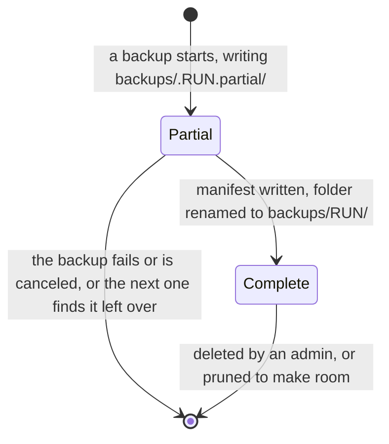
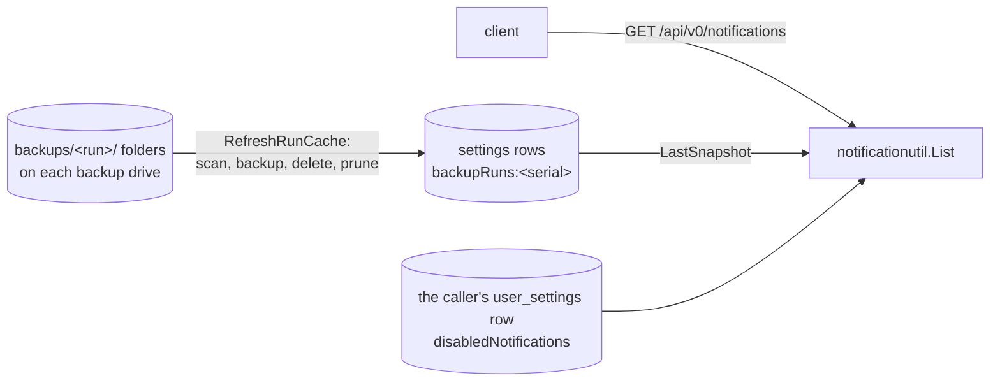
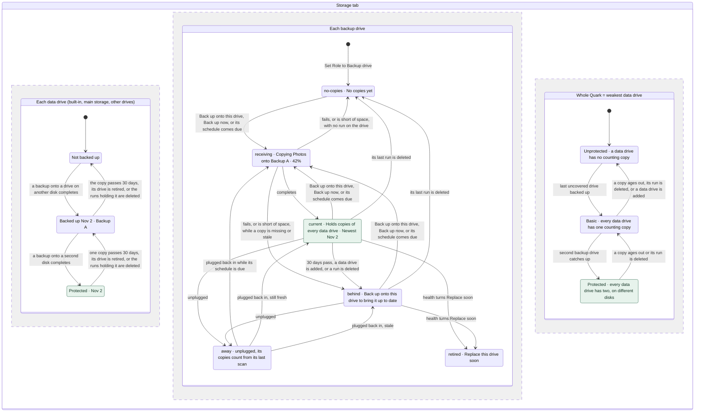

# Backup

`pkg/backup` copies a Quark onto a managed device that holds the `snapshot-backup` role. This page covers what a
snapshot holds, how its runs are listed, deleted and pruned, how a backup drive is backed up onto on a schedule, how a restore or verify picks one, how the chat and vault
tables get into it and back out, how an admin is reminded to take one, and how protected the files are. How the file copies survive a power cut is in
[Durability](durability.md).

## What a snapshot holds

Each snapshot is a **run**: one folder under `backups/` at the root of the backup drive's files directory, named
after the minute it started in the Quark's local time (#4032).

```text
backups/
  2026-11-07 21.57/
    Built-in storage/
    Photos (USB 90C82C65)/
    backup_manifest.json
    chat_backup.db
    chat_backup.db.mac
    vault_items_backup.db
    vault_items_backup.db.mac
  2026-11-08 07.10/
    ...
```

| Entry                                             | What it is                                                                                    | Written by       |
| ------------------------------------------------- | --------------------------------------------------------------------------------------------- | ---------------- |
| `Built-in storage/`, `<name> (USB <serial8>)/`    | each source drive's files, one folder per source drive                                        | `SnapshotBackup` |
| `chat_backup.db`                                  | the chat tables (SQLite installs only)                                                        | `ExportChat`     |
| `vault_items_backup.db`                           | every account's vault key and vault items (SQLite installs only)                              | `ExportVault`    |
| `chat_backup.db.mac`, `vault_items_backup.db.mac` | the MAC that binds each file above to this Quark ([Binding](#binding-a-backup-to-this-quark)) | `SnapshotBackup` |
| `backup_manifest.json`                            | when the run completed, which drive each folder holds, and the SHA-256 and size of every file | `WriteManifest`  |

- **Run folder.** `YYYY-MM-DD HH.MM` (`runFolderLayout`). The name has no `:`, so FAT and exFAT take it, and it sorts
  by time. A second run started in the same minute is `<minute> (2)`, then `(3)`, and so on.
- **Drive folders.** Built-in storage is `Built-in storage`. Any other drive is its name and the first 8 characters
  of its serial, as `Photos (USB 90C82C65)` (`driveDirName`). The folder name is for people only: the manifest's
  `drives` list records each folder's source serial and the drive's name when the run was taken, and restore finds
  a folder's drive there, never by parsing the name.
- **The manifest.** `backup_manifest.json` holds `createdAt`, `completedAt`, `drives`, `totalFiles`, `totalBytes`,
  and then `files`, keyed by path relative to the run's folder. Everything a run is listed by comes before the file
  list, so `ListRuns` reads each manifest as a stream of tokens and stops at `files`, which grows with the drive.
- **Partial runs.** A run is written under `backups/.<run>.partial/` and renamed to `backups/<run>/` only once its
  manifest is written. A run that fails or is canceled deletes its partial folder, and every run first deletes any
  partial folder a stopped Quark left behind (`removeStalePartials`). Nothing that reads runs (listing, restore,
  verify, protection) ever sees a partial folder, and one cannot be deleted through the API.
- **Hard links.** A file whose size matches its copy in the newest complete run holding its drive, and that is not
  newer than that copy, is hard-linked from it rather than copied (`linkUnchanged`, through `vfs.Linker`). That run
  need not be the newest, since a run may hold only some drives. Each run is still
  complete on its own, so deleting any run never breaks another. A drive that cannot link (FAT, exFAT, or a namespace
  with no `vfs.Linker`) gets a full copy of every file; `linksWork` finds that out once per run by linking the
  previous run's manifest into the partial folder and removing the link.
- **`backups/` is never a source.** Every source walk skips a drive's own top-level `backups/` folder
  (`skipBackupsDir`), so when built-in storage is a backup drive and is later copied onto a USB backup drive, its
  runs are not copied with its files. Live sync (`SyncWorker`) leaves the folder alone too: nothing in or moved into
  built-in storage's `backups/` is mirrored onto the default-storage drive.

The sources are the data drives: every managed device but the target and the other `snapshot-backup` drives
(`gatherSourceDevices`), so one backup drive never holds a copy of another (#4037). A backup can be given
`sourceSerials`, the data drives to copy, and then copies only those and is named after them (#3984). Built-in
storage is the serial `""`, as it is for a target. A named serial that is the target, another backup drive, or not
attached is refused before the job is queued (`ErrSourceNotDataDrive`, a 400). Empty or absent is every data drive.
A drive named but unplugged between the start and the run is skipped, as any source is. The rest of `quark.db` is not
in a snapshot. Accounts, sessions, groups, albums and access grants are lost with
the internal disk and are set up again by hand.

On PostgreSQL a run holds the drive folders and the manifest only: see [On PostgreSQL](#on-postgresql).

### Older snapshots in the root layout

Before #4032 a snapshot wrote straight into the root of the backup drive's files directory: an `internal/` folder
and one `<name>_<serial8>/` folder per drive, with `backup_manifest.json`, `chat_backup.db`,
`vault_items_backup.db` and their `.mac` files beside them, rewritten in place on every run. **That layout is not
read.** Restore, verify, the run list and protection status read `backups/` only, and nothing deletes the old
folders. The release note for this change, which the pull request carries because the repository keeps no
release-notes file, is:

> Snapshot backups now live in dated folders under `backups/` on the backup drive, one folder per backup. A backup
> taken before upgrading sits at the drive's root and is no longer read by Restore files, Restore vaults, Restore
> chat or Verify, so take a new backup after upgrading. Once a new backup exists, the old root folders (`internal/`,
> each `<name>_<serial>/`, `backup_manifest.json`, `chat_backup.db`, `vault_items_backup.db` and their `.mac` files) can be
> deleted by hand.

## The run lifecycle

The `backups/<run>/` folders are the only record of which backups exist and what each holds (#4044). Deleting a run
is deleting its folder; no table has to follow. Both routes are admin-only.



- **Listing.** `GET /api/v0/storage/devices/snapshot-backup/runs?deviceSerial=` (`backup.ListDriveRuns`) lists a
  backup drive's complete runs, newest first: each run's `folder`, `completedAt`, `drives`, and `sizeBytes`, the
  manifest's `totalBytes`. A file hard-linked between runs counts in each, so deleting a run can free less than
  its size. A partial run is not listed. A drive without the `snapshot-backup` role is a 400, and one that is not
  attached is a 404.
- **Deleting.** `DELETE /api/v0/storage/devices/snapshot-backup/runs`, body `{"deviceSerial": ..., "run": ...}`
  (`backup.DeleteRun`), deletes one listed run through the drive's namespace for good; it does not go to the trash.
  Every run is complete on its own, so no other run loses a file. Any other name, a partial run or a path out of
  `backups/` included, is a 404. It is a 409 (`ErrDriveBusy`) while a backup onto the drive is pending or running,
  because that backup may be linking from any run, and while a restore job reads that run (`GetActiveRestoreJob`;
  the job's params name its run). Afterwards the drive's `backupRuns:<serial>` row is rewritten, so the protection
  status reads without the run, and `backup_deleted` is published with the drive's serial and the run. Like the
  other backup events it reaches admins only.
- **Pruning.** Before a backup copies anything, it works out how many bytes the run will copy rather than link: every
  file that is new or changed since its drive's newest complete run, or every file when the drive cannot link. When the
  drive's free space is less than that, it deletes the oldest complete run, one at a time, reading the free space
  again after each, because a run sharing hard-linked files frees less than its `sizeBytes` (`makeRoom`). The newest
  complete run is never pruned, nor any drive's newest copy (the newest run whose manifest's `drives` names that
  drive, since a run may hold only some drives), nor a run a restore is reading (`prunable`). Each prune publishes
  `backup_deleted`, and the drive's cache row is rewritten once pruning ends. When even deleting every run pruning
  may delete would leave too little room, the backup fails before copying with "not enough space on <drive> for
  this backup: delete old backups or use a bigger drive" (`ErrNotEnoughSpace`), and the app shows that sentence; runs already pruned stay deleted. Free space
  comes from `vfs.SpaceReporter`, which the disk-backed namespaces implement through `statfs`; a drive that cannot
  report it is not pruned, and a backup onto it fails only if it runs out of room mid-copy.

## Scheduled backups

Each backup drive can carry a schedule (#3984), kept in one settings row, `backupSchedule:<serial>`, as JSON:
`{"cadence": "off|daily|weekly|monthly", "sourceSerials": [...]}`. No row, a row that does not parse, or an unknown
cadence is `off`. Empty `sourceSerials` is every data drive. A schedule is the drive's own, so it outlives the drive
being unplugged; one left on a drive that loses the role does nothing until the role comes back.

- **Due.** A schedule is due when its cadence is not `off` and the newest run on the drive holding any of its sources
  (any run, when every data drive is scheduled) completed longer ago than the cadence, 24 hours, 7 days or 30 days, or
  there is no such run. The runs are read as protection status reads them (`DriveCopies`): from the folders when the
  drive is attached, from its `backupRuns:<serial>` row when it is away. "Any" rather than "all" of the sources keeps a
  source that is gone for good from making the drive due again after every run.
- **Trigger.** `backup.StartDueBackups` runs every 15 minutes, once across instances (`workerutil.RunPeriodically`,
  `backup-schedule`), and on every device change (`OnDevicesChanged`, registered after the VFS namespace sync), so an
  overdue drive starts within one USB poll of being plugged in. For each `snapshot-backup` drive whose schedule is on,
  it skips a drive that is not attached or not due, and starts `StartSnapshotBackup` as the system (user 0) with the
  schedule's sources. A source that is no longer an attached data drive is left out of that run, and when none is
  left nothing starts. A backup already pending or running is skipped silently: two triggers at once, on one instance
  or two, queue one backup, because the jobs table allows one per target. A Replace soon drive is skipped and
  logged: a schedule never stands in for the health acknowledgment. Any other failure is logged and the next drive is
  tried.
- **Backoff.** A backup that fails leaves no run, so its drive stays due. The row records `lastStartedAt` each time
  the schedule queues a backup, and no other starts until 6 hours have passed (`scheduleRetryAfter`), or the cadence
  if that is shorter. Retry in Jobs still starts one at once, and saving the schedule clears `lastStartedAt`.
- **API.** Both routes are admin-only. `GET /api/v0/storage/devices/snapshot-backup/schedule?deviceSerial=` answers
  `{deviceSerial, cadence, sourceSerials, due, waitingForDrive}`; `waitingForDrive` is `due` on a drive that is not
  attached, which the app shows as due and starting once the drive is plugged in.
  `PUT /api/v0/storage/devices/snapshot-backup/schedule`, body `{deviceSerial, cadence, sourceSerials}`, saves it for
  a drive that may be away. An unknown cadence, a drive without the role, or a source that is the drive or another
  backup drive is a 400; a source that is not attached is kept. When the new schedule is due and the drive is
  attached, the backup starts at once and the response carries its `jobId`. It publishes `backup_schedule_changed`
  with the drive's serial, which reaches admins only, like the other backup events.

## Restoring and verifying a run

Restore files (`POST /api/v0/storage/devices/snapshot-backup/restore-files`), restore vaults (`.../restore-vault`),
restore chat (`.../restore-chat`) and verify (`.../verify`) each take an optional `run`, a folder as the run list
names it. Empty or absent is the newest complete run, and each answer's `run` names the one used. Only a listed run
is read: an unknown name, a partial run, or a path out of `backups/` is a 404.

- **Restore files** (`backup.StartRestoreFiles`) maps each drive folder in the run to its drive through the manifest's
  `drives`, never through the folder's name. A drive that is attached gets its files back; a file already there is
  kept as it is. With `missingToBuiltIn`, a drive that is gone has its files put in a folder of the same name on
  built-in storage; without it, they stay on the backup drive and the answer names them. The job's params record the
  run, which is what holds a delete of that run off while the restore runs.
- **Restore vaults** reads `vault_items_backup.db` and its MAC from the run's folder
  ([Restoring the vault](#restoring-the-vault)).
- **Restore chat** reads `chat_backup.db` and its MAC from the run's folder ([Restoring chat](#restoring-chat)).
- **Verify** (`backup.VerifyBackup`) checks the run's files against its manifest: sizes, or hashes with `full`. A
  drive with no complete run is a 400 with `ErrNoManifest`, "nothing to verify yet: back up onto this drive first".
  Restore on such a drive is a 404 (`ErrNoSnapshot`), which the app shows as "There are no backups on this drive yet.
  Back up onto it first."

In the app, the restore dialogs name the run they read ("From the backup of Nov 2, 09.00.", the run folder in the
Quark's local time) and offer a menu of the drive's runs when it holds more than one. Verify checks the newest run
and its snack bar names it ("Verified the backup of Nov 2, 09.00: 1204 files OK.").

## The chat export

`ExportChat` runs on every snapshot of a SQLite-backed Quark and asks for no password; on PostgreSQL the chat is in
the operator's database backup instead ([On PostgreSQL](#on-postgresql)). Message bodies, reactions and channel keys are
encrypted on the client under keys the Quark never holds, and the rest of what the chat tables store is public
keys, signatures, and who posted in which channel when. The copy is exactly as private as the database it came
from, so it is not encrypted a second time.

`chat_backup.db` is a SQLite file whose schema is `internal/db/chat_backup_schema.go`: the twelve chat tables
(`chat_servers`, `chat_channels`, `chat_channel_members`, `user_chat_keys`, `chat_channel_keys`,
`chat_key_grants`, `chat_channel_events`, `chat_messages`, `chat_reactions`, `chat_polls`,
`chat_poll_answers`, `chat_attachments`) with the live columns and none of
the constraints, plus a `users` and a `groups` table that hold only an id and a name. Its `user_version` is the
format version, `db.ChatBackupVersion`.

The export attaches the file to a connection of the live database and copies each table with one
`INSERT ... SELECT`, all in one transaction. Rows never pass through Go, so a long history costs no heap, and the
file is one moment of the chat. It is built under a temp name and renamed over the previous `chat_backup.db`, so
a failed export leaves the last good one in place. `quark.db` is not in WAL mode, so a write to it waits for the
copy to finish; that is the limit to revisit if a history ever takes more than a few seconds to copy.

The export is one case of `ciphertextBackup` (`pkg/backup/ciphertext_backup.go`), which the vault export
shares: a file name, a schema, the tables to copy, and the restore's steps.

`chat_attachments` names each attachment's ciphertext file. The file itself lives under `chat-attachments` in
the data directory, which this export does not copy.

## Restoring chat

`ImportChat` restores `chat_backup.db` in one transaction. A restore that is refused or fails changes nothing.

**It restores only into an empty chat.** A chat with any message, or any channel other than the `general` a new
install starts with, is refused with `ErrChatNotEmpty`; there is no merge. What an empty chat does hold (the
seeded server and `general`, and any channel keys or grants clients made for it at sign-in) is deleted and
replaced by the backup. Server, channel, key-version and message ids come back unchanged, because a ciphertext is
bound to its channel id and key version, and message ids are what paging walks.

**Accounts are matched by username, groups by name.** The backup does not carry accounts, and a rebuilt Quark
numbers them in whatever order they are created. Create the accounts before restoring: an account missing at
that point is treated the way the schema treats a deleted one, and the restore cannot be run a second time to
pick it up.

| The backup's account is                 | What the restore does                                                    |
| --------------------------------------- | ------------------------------------------------------------------------ |
| here, under the same id                 | everything comes back as it was                                          |
| here, under a different id              | memberships, messages, reactions and its chat keys follow it to the new id; grants made out to it are dropped |
| not here                                | its messages and events stay with no author; its memberships, reactions and chat keys are not restored; grants made out to it stay with no recipient |

Grants are the exception because a grant's signature covers the recipient's account id
(`chatutil.GrantMessage`). Moved to another id it would never verify, and it would hold the one slot a valid
grant for that member and key version could take. Dropped, the member simply lacks that key version and is
handed it again by any member who still holds it. A grant with no recipient is how the Quark already knows a
channel key has to rotate. Recreating the accounts in their original order keeps the ids, and with them every
grant.

A restored account's chat identity replaces the one a sign-in on the new install generated, so the user unlocks
it with the password or recovery phrase they had when the backup was taken. `ImportChat` returns the usernames
it could not match in `UnmatchedUsers`.

An admin restores it with `POST /api/v0/storage/devices/snapshot-backup/restore-chat` (#2428), which takes the
vault restore's body, `{"deviceSerial": ..., "password": ..., "run": ...}`, re-confirms the admin's auth key the same
way, and shares the sign-in rate limit. `backup.RestoreChat` checks the drive, the run and the file exactly as
`RestoreVault` does, through `ciphertextBackup.fromDrive`: the drive must have the `snapshot-backup` role
(`ErrChatRestoreRoleRequired`, a 400), and the file its [binding](#binding-a-backup-to-this-quark). A chat that is
not empty is a 409. Once it commits, every channel's members are sent `chat_channel_changed`
(`chatutil.PublishChannelsChanged`): open clients reload their channels, and `WatchKeyNeeds` asks the key holders to
hand out any grant the restore left behind.

## The vault export

`ExportVault` runs on every snapshot of a SQLite-backed Quark beside the chat export and, like it, asks for no
password (#3460); on PostgreSQL the vault is in the operator's database backup instead
([On PostgreSQL](#on-postgresql)). Each
account's vault items are encrypted on the client under that account's vault key, and the key is stored only
wrapped under the account's password and, when the client had it, its recovery phrase. The copy of
`vault_keys` and `vault_items` is exactly as private as the database it came from, and a restored vault opens
with the password or phrase that opened it before.

`vault_items_backup.db` is a SQLite file whose schema is `internal/db/vault_items_backup_schema.go`: the two
vault tables with the live columns and none of the constraints, plus a `users` table holding only an id and a
username. Its `user_version` is `db.VaultItemsBackupVersion`. It is built exactly as `chat_backup.db` is. The
name is not `vault_backup.db`, which older snapshots hold: that is the household vault, re-encrypted under a
recovery password, which this build no longer reads.

## Restoring the vault

An admin restores it with `POST /api/v0/storage/devices/snapshot-backup/restore-vault`, body
`{"deviceSerial": ..., "password": ..., "run": ...}`, which `backup.RestoreVault` serves from one run on the backup
drive (#3614). `run` is a run folder as the run list names it; empty or absent is the newest complete run, and the
answer's `run` names the one read ([Restoring and verifying a run](#restoring-and-verifying-a-run)). `password`
is the admin's auth key, re-confirmed the way `DELETE /vault` does (#3615), and the route shares the sign-in rate limit.
The drive must have the `snapshot-backup` role (`ErrVaultRestoreRoleRequired`, a 400): a restore reads only the drive
snapshots are written to, never whatever attached drive holds a file of the right name. `ImportVault` restores `vault_items_backup.db` in
one transaction, the way `ImportChat` restores the chat. A restore that is refused or fails changes nothing.

- **It restores only while no account has a vault item** (`ErrVaultNotEmpty`, a 409).
- **A vault goes to the account whose username is the backup's, letter for letter**, the lookup sign-in makes. There
  is no other identity that survives a move to new hardware, so nothing is guessed: `Carol` on the new Quark is not
  `carol` in the backup. A backed-up vault with no such account refuses the whole restore (`ErrVaultAccountMissing`,
  a 409 naming every such username). It is not skipped, because once any vault has items a second restore is
  refused, and the skipped vault could never come back. An admin adds the accounts, with any password, and restores
  again; one nobody wants back can be deleted afterwards, which deletes its vault. A backup account with no vault
  and no account here only comes back in `UnmatchedUsers`.
- **A vault key is never replaced** (quark-project#267). A backed-up vault whose account here already has a vault key,
  even one with no items, refuses the whole restore (`ErrVaultKeyExists`, a 409 naming every such account). A session
  open on that account would otherwise go on sealing items under a key that no longer exists. The account can delete
  its empty vault (`DELETE /vault`) and the admin restores again. The insert is a plain `INSERT`, never `OR REPLACE`.
- **Every backed-up row passes the checks an API write does.** Each key goes through `vaultutil.ValidateKey` (the
  algorithm allowlist, the Argon2id floor and ceiling from #3648, 16-byte salts, wrap sizes) and each item through
  `ValidateItem`, with its ciphertext at most `vaultutil.MaxItemRequestBytes`. Any failure refuses the whole restore
  (`ErrVaultBackupInvalid`, a 400 naming the accounts).
- A matched account's vault key and items come back byte for byte, the items under their old ids.
- `restoredAccounts` names every account that got a vault back, and each is sent `vault_changed`. Every attempt
  past the password check is written to the server log with the admin, the drive's serial, and the accounts and item
  count, or the refusal.
- A drive with no complete run, a run the drive does not hold, and a run with no backup file are each a 404, which
  names the file but not where the drive is mounted.
- **The file must be one this Quark wrote** (`ErrBackupNotFromThisQuark`, a 400 saying why): see
  [Binding a backup to this Quark](#binding-a-backup-to-this-quark).

**Which password opens a restored vault.** The wrapped key carries the salt it was derived over (`salt_pw`), and
the app unlocks over that salt, so a restored vault opens with the password its account had when the backup was
taken, whatever the account signs in with now. A new install derives every account's auth salt from a secret of its
own, so on new hardware every restored vault is in that state, and `backupPasswordAccounts` names those accounts. The
recovery phrase of backup time does not get them back in: `/auth/recover` checks the account's recovery key on this
Quark, and its phrase wrap is kept but nothing opens it yet. Re-wrapping such a vault under the account's current
password, once the old one has opened it, is the app's to do.

The backup holds the wrapped keys and never the accounts' auth salts, auth key hashes or recovery key hashes. Carrying
those would let a restore bring the old password and phrase back as sign-in credentials, at the price of a backup
drive that holds what a password guess is checked against.

<!-- cspell:ignore HMAC -->

## Binding a backup to this Quark

Restore checks the drive's role, the usernames and the ciphertext's shape, and none of those say who wrote the file.
So a snapshot binds `chat_backup.db` and `vault_items_backup.db` to the Quark that wrote them (#4010), and a restore
refuses a file this Quark did not write, changes nothing, and says why.

- **The MAC.** Beside each file a snapshot writes `<file>.mac`: the hex of HMAC-SHA256 over the file's name, a NUL,
  and its bytes. The key is HKDF-SHA256 over the install's salt secret (`settingsutil.AuthSaltSecretIn`, the 32
  random bytes in the `authSaltSecret` settings row that already key `/auth/salt`), with its own label. The secret is
  in `quark.db`, which no snapshot copies, so nothing on the drive can produce the key. HKDF rather than
  `HMAC(secret, label)`, because `/auth/salt` answers `HMAC(secret, username)` for any name asked. No new table, no
  new dependency, and no new secret to lose.
- **The drive record.** Before it writes the first bound file to a drive, a snapshot writes the settings row
  `backupBound:<serial>`. A file with no MAC on a drive this Quark has bound is refused, so deleting the MAC does not
  pass a planted file off as an old snapshot.
- **Unbound files.** A file with no MAC, on a drive with no record, restores: that is what a snapshot taken before
  binding wrote. Those snapshots sit in the root layout, which restore no longer reads
  ([Older snapshots](#older-snapshots-in-the-root-layout)), so in practice every run a restore reads is bound.
- **What it does not cover.** The key is this install's. A Quark rebuilt on new hardware has a new salt secret and
  refuses the bound files of the one it replaces; a bundle (`quark bundle export`) carries the settings rows, secret
  included, so a Quark moved by bundle keeps restoring its own snapshots. A drive this Quark never bound still takes an
  unbound file. The MAC and its file are written inside the run's partial folder, so a power cut between the two
  leaves a pair no restore reads, and the next run deletes it.

`ExportChat` and `ExportVault` on their own write unbound files and remove a stale MAC; only `SnapshotBackup` binds.
On PostgreSQL a run holds neither the files nor their MACs.

## On PostgreSQL

On an install whose main database is PostgreSQL, the database is backed up by the operator's own PostgreSQL
backups (`pg_dump`, or a managed service's backups), and Quark's snapshot backup covers the files only. A run
there holds the drive folders and `backup_manifest.json`, and no `chat_backup.db` or `vault_items_backup.db`:
the chat and the vault are rows in that database, and its backups carry them with everything else in it, accounts
included. `ExportChat`, `ImportChat`, `ExportVault` and `ImportVault` return `ErrDatabaseBackedUpSeparately` and
write nothing. Every run is a new folder, so a run taken on PostgreSQL never carries an export an earlier SQLite run
wrote; that run keeps its own. [Running Quark in a container](../container.md#backup-and-restore) has the procedure.

What each kind of backup restores onto:

| Backup                                       | Restores onto                                            |
| -------------------------------------------- | -------------------------------------------------------- |
| a run's drive folders                        | either backend: they are plain files                     |
| `chat_backup.db`, `vault_items_backup.db`    | SQLite only                                              |
| a `pg_dump` of the database                  | PostgreSQL only                                          |
| a bundle (`quark bundle export`)             | a new install on either backend, from either backend     |

A bundle holds every row of the database and the internal drive's files, and starts a new, uninitialized install
in all four directions: SQLite or PostgreSQL to SQLite or PostgreSQL. See
[Moving a whole Quark to a new install](bundle.md).

## Backup reminders

An admin is reminded when no backup drive holds a complete run (`backup_due`) or when the newest run on any of
them is 30 days old (`backup_stale`). There is no notifications table and no worker. The reminder is worked out
when it is asked for, and it follows the run folders like the protection status does:



1. The record is the runs. Every scan of an attached backup drive, every completed snapshot, and every deleted or
   pruned run rewrites that drive's `backupRuns:<serial>` row from its folders (`backup.RefreshRunCache`; see
   [How protected the files are](#how-protected-the-files-are)). `backup.LastSnapshot` reads the row of every
   drive with the `snapshot-backup` role and returns the newest `completedAt` among them, so a drive that is away
   still counts, a drive that loses the role stops counting, and deleting or pruning the last run brings
   `backup_due` back. A failed backup leaves no run and changes nothing. Every instance on the database reads the
   same rows.
2. `GET /api/v0/notifications` (`v0_notifications`) reads the caller's own settings and calls
   `notificationutil.List`. A caller who is not an admin gets an empty list. An admin gets `backup_due` when no
   backup drive holds a run, `backup_stale` when the newest run is at least `notificationutil.BackupStaleAfter`
   old, and nothing otherwise. A type the caller listed in `disabledNotifications` (`PUT /api/v0/settings/me`) is
   left out.
3. No event announces a notification. The list changes when a backup completes (`backup_completed`), when a run is
   deleted or pruned (`backup_deleted`), when the caller saves their own settings, and as time passes, so a client
   asks again on those.

Because the list is derived, a reminder cannot repeat or pile up, and it is gone as soon as a backup completes.
That covers the coalescing and rate limiting these two types need. A type that reports a one-time event, such as
a calendar reminder, will need stored notifications; that belongs to the epic (#1145).

Push delivery is #1150. The `lastSnapshotBackup` rows and the `last-snapshot-backup` file that recorded the time
apart from the runs are gone: migration 048 deletes the rows, and a Quark that last backed up in the root layout
reads as never backed up until its next snapshot ([Older snapshots](#older-snapshots-in-the-root-layout)).

<!-- cspell:ignore libexec protectionutil sda smartctl statfs -->

## How protected the files are

`GET /api/v0/storage/protection` reports how protected each drive's files are, worked out from the roles, the
connected drives, and what the backup drives' runs hold. `protectionutil.Status` takes what the handler has
already loaded, and it does not open the database or the filesystem.

Drives come in two kinds:

- A **data drive** is every connected drive whose role is not `snapshot-backup`: built-in storage, the
  default-storage drive, and unassigned drives. Its files are what needs protecting.
- A **backup drive** is every `snapshot-backup` drive, connected or not. It holds copies.

**Copies come from the run folders** (#4037, #4044). A backup drive's copy of a data drive is its newest complete
run whose manifest's `drives` names that data drive's serial, dated by the run's `completedAt`. A partial run never
counts. The handler asks `backup.DriveCopies` for each backup drive:

- An attached backup drive is scanned on every request (`ListRuns`, reading only each manifest's head), and the scan
  rewrites the settings row `backupRuns:<serial>` with what it found, an empty list included
  (`backup.RefreshRunCache`). A snapshot rewrites the row once its run is in place, and deleting or pruning a run
  rewrites it too.
- A backup drive that is away (it holds the role and has no files namespace) answers from that row, so the data
  drives it backed up keep their copies while it is unplugged. A drive never scanned has none.
- A scan that fails is logged and answered from the row, which it leaves as it was, so one unreadable drive does not
  fail the status of every other.

The row is only a cache: whenever the drive is attached, its folders win, so a run folder deleted outside the app is gone
from the status on the next read. There is no table and no migration. The job rows are not
read.

A backup drive's copy of a data drive counts when all of these hold:

- the backup drive's health verdict is not Replace soon. Watch and Unknown still follow the other rules;
- the copy finished inside 30 days (`protectionutil.StaleAfter`, the same window as `backup_stale`);
- the backup drive is on a different physical disk from the data drive. A copy on built-in storage protects a USB
  default-storage drive, and never built-in storage's own files.

Two partitions of one backup disk count once per data drive; the newer copy is the one that counts. The whole-disk
key comes from `Device.DevicePath`: `/dev/disk3s5` and `/dev/disk3s1` share `disk3`, and `/dev/sda1` and
`/dev/sda2` share `sda`. An empty `DevicePath` stands alone, which is also how an unplugged drive is grouped,
because its path is not available until it is attached. A copy that does not count carries one sentence saying why:
stale, same disk as the drive, same disk as another copy, or on a Replace soon drive.

| Level (chip wording) | Meter wording | A data drive with                              |
| -------------------- | ------------- | ---------------------------------------------- |
| `unprotected`        | Unprotected   | no counting copy: the chip reads Not backed up |
| `basic`              | Basic         | one counting copy: Backed up Nov 2 · Backup A  |
| `protected`          | Protected     | counting copies on two or more different disks |

The whole Quark's `level` is the weakest data drive's, and `sentence` is written from that drive ("Photos has no
recent backup. Back up onto your backup drive."). `nextStep` is `start-backup` when some backup drive that is not
Replace soon, not on the weakest drive's disk, and not already counted for it could add a counting copy;
`assign-backup-role` when none can; and `keep-one-elsewhere` when every data drive is protected. Offsite is not
tracked.

The response lists `dataDrives`, each with its level and its copies newest first (backup drive, date, whether it
counts, why not), and `backupDrives`, each with its state, the data drives it `holds`, and its `newestCopy`. A
backup drive's state is the first of these that applies:

| State       | When                                                                                          |
| ----------- | --------------------------------------------------------------------------------------------- |
| `retired`   | its health verdict is Replace soon; none of its copies count                                  |
| `receiving` | a snapshot backup onto it is pending or running                                               |
| `away`      | it holds the role and is not connected; its copies still count from its cached scan          |
| `no-copies` | it holds no copy of any drive                                                                 |
| `current`   | it holds a copy inside 30 days of every data drive on another disk                            |
| `behind`    | a data drive on another disk is missing from it, or its copy is older than 30 days            |

The live copy that `SyncWorker` keeps on a USB default-storage drive is a mirror, not a snapshot, and never counts.
Live sync does not erase a backup drive either: it mirrors the internal drive onto the default-storage drive only,
and a user delete is not copied there (`pkg/backup/sync.go`, #2791).

The device list (`GET /api/v0/storage/devices/status`) carries `activeBackupJobId` on a backup drive with a pending
or running backup, and the backup job's status carries `targetName`, `sourceNames`, and `currentSource`, so every
open client can show and follow a backup it did not start. When a snapshot backup completes or fails,
`SnapshotBackup` publishes `backup_completed` or `backup_failed`, and when a run is deleted or pruned,
`backup_deleted`. An open client loads protection status again on each, and the drives' runs on `backup_completed`
and `backup_deleted`.

## Backup state machine

Drives split into two roles. A data drive (built-in storage, the default-storage drive, any other drive that is
not a backup drive) is backed up or not. A backup drive holds copies and is current or behind. The whole-Quark
level is the weakest data drive's, and the running state comes from the server rather than the tab (#4037). Every
state is read from the backup drives' run folders, so deleting or pruning a run moves a drive back as surely as a
backup moves it forward.



- A data drive's card carries a chip with its own state, which opens to one line per backup drive's copy and the
  reason a copy does not count. It has no backup button: the data drives are copied by backing up onto a backup
  drive.
- A backup drive's card never carries a protection badge. It says what the drive holds ("Holds copies of Built-in
  storage, Photos. Newest Nov 2.") and offers **Back up onto this drive**, **Verify**, **Restore files**,
  **Restore vaults** and **Restore chat**. For an admin it also lists the drive's runs, collapsed at first ("2 backups · newest Nov 2"),
  each with its time, size and drives and a delete action. An away drive has no card, because the device list has
  only connected drives; its copies still show on the data drives' chips.
- The protection card keeps the whole-Quark meter and sentence and gains **Back up now**, which starts a backup onto
  every connected backup drive that is not receiving or retired. The "Back up this Quark" reminder links to the
  Storage tab, where that button is.
- The progress shows on the receiving backup drive's card and names the drives. It clears when the backup finishes,
  and the result stays as the card's state. A backup started in another tab or by another admin is found through
  `activeBackupJobId`, so its progress shows and the drive actions are disabled everywhere.
- A failed backup is a snack bar, not an error kept on the backup drive's card; the drive goes back to the state its
  runs give it. A backup that failed for lack of space shows the Quark's sentence, and any other failure says the
  backup didn't finish without its diagnostic.
- A backup drive with a schedule moves to Receiving on its own when the schedule comes due, and an away drive does
  the moment it is plugged back in while due ([Scheduled backups](#scheduled-backups)). A Replace soon drive never
  does.

### Where the build differs from the issues

- **Copies are read from the run folders, not recorded per source** (#4037 decision 1). The
  `lastSnapshotBackup:<target>:<source>` rows were never shipped: #4044 made the folders the truth, with the
  `backupRuns:<serial>` cache for drives that are away.
- **A data drive has no Backing up state of its own** (#4037). The progress is on the backup drive's card only.
- **"Assign the backup role" never offers the main storage drive**, so with no other drive attached the step has no
  button.
- **A backup drive's card says "Newest Nov 2"** after what it holds, where #4037 proposed "Newest copy written".
- **A delete is refused while any backup onto the drive is pending or running**, not only for the run being
  written (#4044), because that backup may be linking from any run. It is also refused for a run a restore is
  reading, and pruning skips that run.
- **Pruning needs the drive to report its free space.** A drive that cannot is not pruned.
- **The root layout is not read** (#4032 left the choice open). See
  [Older snapshots](#older-snapshots-in-the-root-layout).

## Drive health

Every managed drive gets a verdict on `GET /api/v0/storage/devices/status`, in `health` on each device. The
verdict is `healthy`, `watch`, `replace-soon`, or `unknown`, and `reason` is one sentence. `unknown` is what a
failed read returns, including when the health tool is not installed. A failed read is never `healthy`.

On Linux the read is `smartctl` JSON. `quark install` writes `/usr/local/libexec/quark/drive-health` and a
sudoers entry so the service can run it as root. The script accepts only a whole-disk path, tries the disk,
then tries SATA passthrough for USB bridges (`smartctl -d sat`). It does not install `smartctl`. When that
binary is missing the script exits 127 and every drive is `unknown` with a reason that says the health tool is
not installed; the device list still loads. Without the helper, the service runs `smartctl` itself the same
way and treats a missing binary the same. On macOS the verdict comes from the `SMART Status` line of
`diskutil info`: Verified is healthy, Failing is replace soon, and Not Supported or a missing line is unknown.

Age is power-on hours, not a manufacture year. A drive with 40000 hours or more is `watch`, and the sentence
says it is heavily used. Reallocated sectors are `watch`. Sectors waiting to be reallocated, a failed SMART
status, or a solid-state drive that has used up its rated life are `replace-soon`.

`health` is nil until the device list reads it, then cached for 15 minutes. `worseThanDefault` is set when a
drive's verdict is worse than the current default-storage drive. The order is healthy, then watch, then
unknown, then replace soon.

Assigning `default-storage` or `snapshot-backup`, and starting a snapshot backup onto a drive that already has
that role, refuses a `replace-soon` drive with 409 unless the body sets `acknowledgeHealth`. Watch does not
block. Unknown does not count as healthy and does not block. Switching default storage onto a drive in worse
health than the current one uses a stronger 409 sentence. Acknowledging leaves files already on the drive in
place. A snapshot writes only under `backups/`: it creates its own run folder, removes the partial folders runs
create for themselves, and prunes old complete runs when it is short of room ([The run lifecycle](#the-run-lifecycle)).
It writes through `vfs.CopyBetween`, which lands a file under its real name only once the copy is whole, and it
does not touch anything outside `backups/`.

Any later format or erase of a drive has to use this same acknowledgment. A `replace-soon` drive must not be
wiped, or chosen as the only remaining copy, without the caller passing it.
