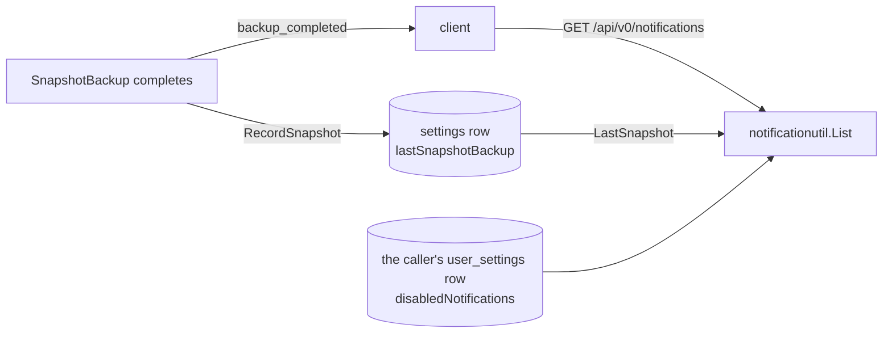

# Backup

`pkg/backup` copies a Quark onto a managed device that holds the `snapshot-backup` role. This page covers what a
snapshot holds, how the chat and vault tables get into it and back out, how an admin is reminded to take one, and how
protected the files are. How the file copies survive a power cut is in
[Durability](durability.md).

## What a snapshot holds

`SnapshotBackup` writes everything under the target device's files directory:

| Entry                             | What it is                                                                | Written by       |
| --------------------------------- | ------------------------------------------------------------------------- | ---------------- |
| `<device>_<serial>/`, `internal/` | every other managed device's files, one directory per source device       | `SnapshotBackup` |
| `chat_backup.db`                  | the chat tables (SQLite installs only)                                    | `ExportChat`     |
| `vault_items_backup.db`           | every account's vault key and vault items (SQLite installs only)          | `ExportVault`    |
| `backup_manifest.json`            | the SHA-256 and size of every file above                                  | `WriteManifest`  |

The rest of `quark.db` is not in a snapshot. Accounts, sessions, groups, albums and access grants are lost with
the internal disk and are set up again by hand.

On PostgreSQL a snapshot holds the files and the manifest only: see [On PostgreSQL](#on-postgresql).

## The chat export

`ExportChat` runs on every snapshot of a SQLite-backed Quark and asks for no password; on PostgreSQL the chat is in
the operator's database backup instead ([On PostgreSQL](#on-postgresql)). Message bodies, reactions and channel keys are
encrypted on the client under keys the Quark never holds, and the rest of what the chat tables store is public
keys, signatures, and who posted in which channel when. The copy is exactly as private as the database it came
from, so it is not encrypted a second time.

`chat_backup.db` is a SQLite file whose schema is `internal/db/chat_backup_schema.go`: the nine chat tables
(`chat_servers`, `chat_channels`, `chat_channel_members`, `user_chat_keys`, `chat_channel_keys`,
`chat_key_grants`, `chat_channel_events`, `chat_messages`, `chat_reactions`) with the live columns and none of
the constraints, plus a `users` and a `groups` table that hold only an id and a name. Its `user_version` is the
format version, `db.ChatBackupVersion`.

The export attaches the file to a connection of the live database and copies each table with one
`INSERT ... SELECT`, all in one transaction. Rows never pass through Go, so a long history costs no heap, and the
file is one moment of the chat. It is built under a temp name and renamed over the previous `chat_backup.db`, so
a failed export leaves the last good one in place. `quark.db` is not in WAL mode, so a write to it waits for the
copy to finish; that is the limit to revisit if a history ever takes more than a few seconds to copy.

The export is one case of `ciphertextBackup` (`pkg/backup/ciphertext_backup.go`), which the vault export
shares: a file name, a schema, the tables to copy, and the restore's steps.

Chat attachments (#2425) are planned as files on the internal device. The snapshot already copies every source
device's files as streams, so they need nothing from the chat export.

## Restoring chat

`ImportChat` restores `chat_backup.db` in one transaction. A restore that is refused or fails changes nothing.

**It restores only into an empty chat.** A chat with any message, or any channel other than the `general` a new
install starts with, is refused with `ErrChatNotEmpty`; there is no merge. What an empty chat does hold (the
seeded server and `general`, and any channel keys or grants clients made for it at sign-in) is deleted and
replaced by the backup. Server, channel, key-version and message ids come back unchanged, because a ciphertext is
bound to its channel id and key version, and message ids are what paging walks.

**Accounts are matched by username, groups by name.** The backup does not carry accounts, and a rebuilt Quark
numbers them in whatever order they are created. Create the accounts before restoring: an account missing at
that point is treated the way the schema treats a deleted one, and the restore cannot be run a second time to
pick it up.

| The backup's account is                 | What the restore does                                                    |
| --------------------------------------- | ------------------------------------------------------------------------ |
| here, under the same id                 | everything comes back as it was                                          |
| here, under a different id              | memberships, messages, reactions and its chat keys follow it to the new id; grants made out to it are dropped |
| not here                                | its messages and events stay with no author; its memberships, reactions and chat keys are not restored; grants made out to it stay with no recipient |

Grants are the exception because a grant's signature covers the recipient's account id
(`chatutil.GrantMessage`). Moved to another id it would never verify, and it would hold the one slot a valid
grant for that member and key version could take. Dropped, the member simply lacks that key version and is
handed it again by any member who still holds it. A grant with no recipient is how the Quark already knows a
channel key has to rotate. Recreating the accounts in their original order keeps the ids, and with them every
grant.

A restored account's chat identity replaces the one a sign-in on the new install generated, so the user unlocks
it with the password or recovery phrase they had when the backup was taken. `ImportChat` returns the usernames
it could not match in `UnmatchedUsers`.

No handler calls `ImportChat` yet; the restore route and its page are still to come (#2428).

## The vault export

`ExportVault` runs on every snapshot of a SQLite-backed Quark beside the chat export and, like it, asks for no
password (#3460); on PostgreSQL the vault is in the operator's database backup instead
([On PostgreSQL](#on-postgresql)). Each
account's vault items are encrypted on the client under that account's vault key, and the key is stored only
wrapped under the account's password and, when the client had it, its recovery phrase. The copy of
`vault_keys` and `vault_items` is exactly as private as the database it came from, and a restored vault opens
with the password or phrase that opened it before.

`vault_items_backup.db` is a SQLite file whose schema is `internal/db/vault_items_backup_schema.go`: the two
vault tables with the live columns and none of the constraints, plus a `users` table holding only an id and a
username. Its `user_version` is `db.VaultItemsBackupVersion`. It is built exactly as `chat_backup.db` is. The
name is not `vault_backup.db`, which older snapshots hold: that is the household vault, re-encrypted under a
recovery password, which this build no longer reads.

## Restoring the vault

`ImportVault` restores `vault_items_backup.db` in one transaction, the way `ImportChat` restores the chat, and
like it has no route yet (#2428). It restores only while no account has a vault item (`ErrVaultNotEmpty`).
Accounts are matched by username. A matched account's vault key replaces any its first sign-in on the new
install made, and its items come back byte for byte under their old ids. An account that is not here is
skipped, and its username comes back in `UnmatchedUsers`.

## On PostgreSQL

On an install whose main database is PostgreSQL, the database is backed up by the operator's own PostgreSQL
backups (`pg_dump`, or a managed service's backups), and Quark's snapshot backup covers the files only. A snapshot
there holds the device directories and `backup_manifest.json`, and no `chat_backup.db` or `vault_items_backup.db`:
the chat and the vault are rows in that database, and its backups carry them with everything else in it, accounts
included. `ExportChat`, `ImportChat`, `ExportVault` and `ImportVault` return `ErrDatabaseBackedUpSeparately` and
write nothing, and a snapshot removes the `chat_backup.db` and `vault_items_backup.db` an earlier SQLite snapshot
left at the drive's root, so the manifest never lists a copy the snapshot did not take. [Running Quark in a container](../container.md#backup-and-restore) has the procedure.

A backup does not restore across backends:

| Backup                                       | Restores onto                              |
| -------------------------------------------- | ------------------------------------------ |
| a snapshot's device directories              | either backend: they are plain files       |
| `chat_backup.db`, `vault_items_backup.db`    | SQLite only                                |
| a `pg_dump` of the database                  | PostgreSQL only                            |

Moving a SQLite install to PostgreSQL is #2962.

## Backup reminders

An admin is reminded when this Quark has no snapshot backup (`backup_due`) or when the last one is 30 days old
(`backup_stale`). There is no notifications table and no worker. The reminder is worked out when it is asked for:

1. When a snapshot backup completes, `SnapshotBackup` writes the completion time to the `lastSnapshotBackup` row
   of the `settings` table (`backup.RecordSnapshot`), where every instance on the database reads it (#3083). The
   job's row is pruned with the rest of the job history and the manifest sits on a drive that may be unplugged, so
   this row is what still knows. A failed backup writes nothing. A Quark that kept the time in the file
   `last-snapshot-backup` in its data directory has it imported on the next start (`backup.ImportLastSnapshot`).
2. `GET /api/v0/notifications` (`v0_notifications`) reads the caller's own settings and calls
   `notificationutil.List`, which reads the record (`backup.LastSnapshot`). A caller who is not an admin gets an
   empty list. An admin gets `backup_due` when there is no record, `backup_stale` when the record is at least
   `notificationutil.BackupStaleAfter` old, and nothing otherwise. A type the caller listed in
   `disabledNotifications` (`PUT /api/v0/settings/me`) is left out.
3. No event announces a notification. The list changes when a backup completes, which already publishes
   `backup_completed`, when the caller saves their own settings, and as time passes, so a client asks again on
   those.

Because the list is derived, a reminder cannot repeat or pile up, and it is gone as soon as a backup completes.
That covers the coalescing and rate limiting these two types need. A type that reports a one-time event, such as
a calendar reminder, will need stored notifications; that belongs to the epic (#1145).

The app does not show these yet. The bell, the list and the toggle for each type are a follow-up to #2493, and
push delivery is #1150. A Quark whose last backup predates the record reads as never backed up until its next
snapshot.

<!-- cspell:ignore libexec protectionutil sda smartctl -->

## How protected the files are

`GET /api/v0/storage/protection` reports a level worked out from the drives and snapshot-backup jobs already on
the Quark. Nothing new is stored for it. `protectionutil.Status` takes the roles, devices, and completed-job
timestamps the handler has already loaded, and it does not open the database or the filesystem.

Copy 1 is the live data on the default-storage drive. It never counts as a backup copy. The internal drive never
counts; assigning it the snapshot-backup role is already refused.

| Level        | When                                                                                                                |
| ------------ | ------------------------------------------------------------------------------------------------------------------- |
| unprotected  | no snapshot-backup drive has a completed backup inside 30 days                                                     |
| basic        | exactly one such drive, after partitions of one disk are grouped                                                   |
| protected    | two or more such drives                                                                                             |

The 30 days are `protectionutil.StaleAfter`, the same window as `backup_stale`. A drive counts only when its role
is snapshot-backup, its health verdict is not Replace soon, and it has a completed snapshot-backup job inside
that window. A failed job, a job that has not completed, a completion older than the window, and a Replace soon
drive do not count. Watch and Unknown still follow the 30-day rule. Quark does not store the result of a verify,
so a completed job is the success signal.

Two partitions of one physical disk count once. The whole-disk key comes from `Device.DevicePath`: `/dev/disk3s5`
and `/dev/disk3s1` share `disk3`, and `/dev/sda1` and `/dev/sda2` share `sda`. A group counts when at least one
member qualifies. An empty `DevicePath` stands alone, which is also how an unplugged drive is counted, because
its path is not available until it is attached.

Offsite is not tracked. The response recommends one next step: assign the backup role, start a backup, or keep
one backup drive somewhere else. It also lists each snapshot-backup drive, whether that drive counts, why not,
and when it was last backed up.

Live sync does not erase a snapshot-backup drive. `SyncWorker` mirrors the internal drive onto the
default-storage drive only, and a user delete is not copied there (`pkg/backup/sync.go`, #2791), so a
snapshot-backup drive still counts when the rules above say so.

When a snapshot backup completes or fails, `SnapshotBackup` publishes `backup_completed` or `backup_failed`.
An open client should refetch protection status on either one.

## Drive health

Every managed drive gets a verdict on `GET /api/v0/storage/devices/status`, in `health` on each device. The
verdict is `healthy`, `watch`, `replace-soon`, or `unknown`, and `reason` is one sentence. `unknown` is what a
failed read returns, including when the health tool is not installed. A failed read is never `healthy`.

On Linux the read is `smartctl` JSON. `quark install` writes `/usr/local/libexec/quark/drive-health` and a
sudoers entry so the service can run it as root. The script accepts only a whole-disk path, tries the disk,
then tries SATA passthrough for USB bridges (`smartctl -d sat`). It does not install `smartctl`. When that
binary is missing the script exits 127 and every drive is `unknown` with a reason that says the health tool is
not installed; the device list still loads. Without the helper, the service runs `smartctl` itself the same
way and treats a missing binary the same. On macOS the verdict comes from the `SMART Status` line of
`diskutil info`: Verified is healthy, Failing is replace soon, and Not Supported or a missing line is unknown.

Age is power-on hours, not a manufacture year. A drive with 40000 hours or more is `watch`, and the sentence
says it is heavily used. Reallocated sectors are `watch`. Sectors waiting to be reallocated, a failed SMART
status, or a solid-state drive that has used up its rated life are `replace-soon`.

`health` is nil until the device list reads it, then cached for 15 minutes. `worseThanDefault` is set when a
drive's verdict is worse than the current default-storage drive. The order is healthy, then watch, then
unknown, then replace soon.

Assigning `default-storage` or `snapshot-backup`, and starting a snapshot backup onto a drive that already has
that role, refuses a `replace-soon` drive with 409 unless the body sets `acknowledgeHealth`. Watch does not
block. Unknown does not count as healthy and does not block. Switching default storage onto a drive in worse
health than the current one uses a stronger 409 sentence. Acknowledging leaves files already on the drive in
place. A snapshot copies onto the target and removes only the temp files that copy, and the chat and vault
exports, create for themselves (`SnapshotBackup` writes through `vfs.CopyBetween`, which lands a file under its
real name only once the copy is whole). It does not erase the rest of the drive.

Any later format or erase of a drive has to use this same acknowledgment. A `replace-soon` drive must not be
wiped, or chosen as the only remaining copy, without the caller passing it.
