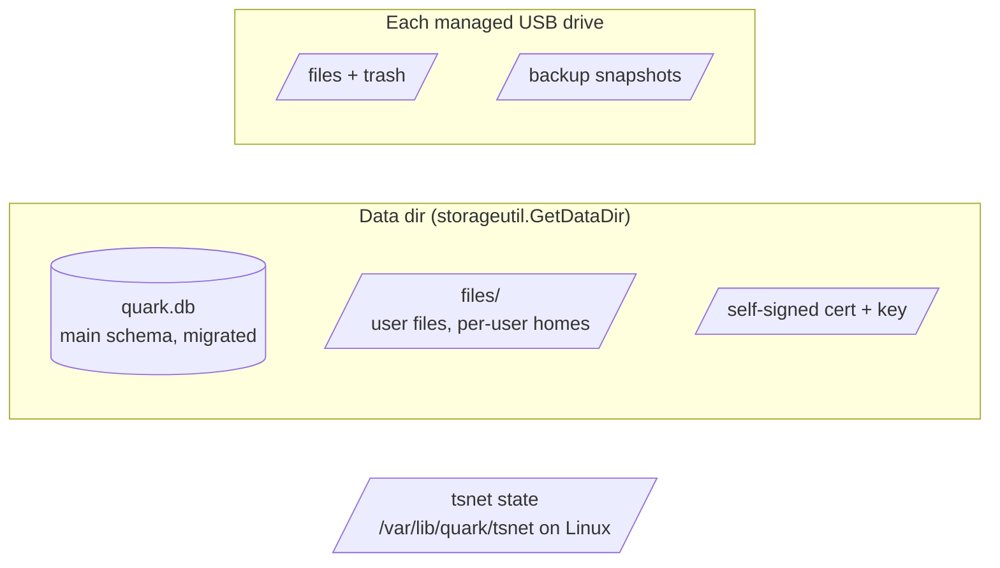
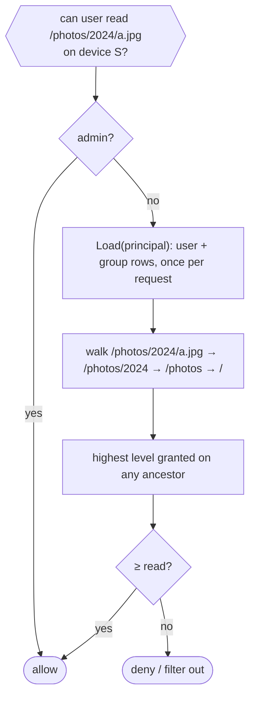
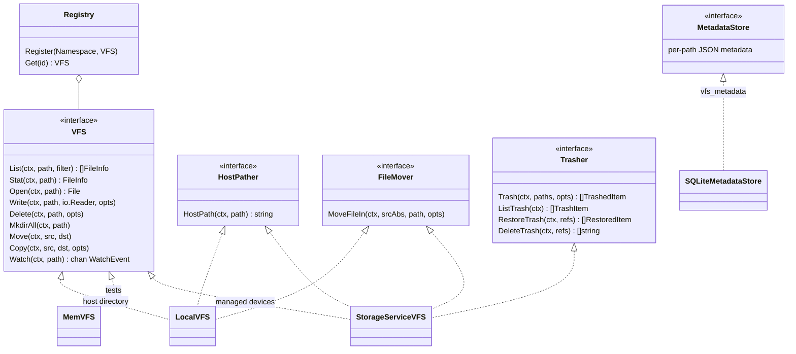

# Data

Files are the primary data and live on disk. The database holds only what cannot: identity, grants, collections,
job history, and indexes. The rule in `AGENTS.md` is to reach for the database last. The database is SQLite unless
the install is pointed at PostgreSQL; see [The PostgreSQL backend](#the-postgresql-backend).

## Where state lives

| Store              | Opened by                         | Schema source                             |
| ------------------ | --------------------------------- | ----------------------------------------- |
| `quark.db`         | `db.ConnectToDatabase`            | `internal/db/migrations` (golang-migrate) |

It and the backup files a snapshot writes use the pure-Go `modernc.org/sqlite` driver, so the binary cross-compiles without cgo.

## The PostgreSQL backend

The main schema can live in a PostgreSQL database in place of `quark.db` (#2955). Two environment variables
choose it when the server starts, and `db.ConfigFromEnv` is the one place that reads them:

| Variable             | Value                                                                              |
| -------------------- | ---------------------------------------------------------------------------------- |
| `QUARK_DB_BACKEND`   | `sqlite`, also when unset or empty, or `postgres`. Anything else refuses to start  |
| `QUARK_DATABASE_URL` | the PostgreSQL connection URL. Required with `postgres`, ignored with `sqlite`     |

With neither set Quark is on SQLite exactly as it was. With `postgres`, `db.ConnectToDatabase` hands over to
`db.ConnectToPostgres`, which connects through pgx's `database/sql` driver, pins the session to UTC, and runs
the migrations in `internal/db/migrations_postgres/` under golang-migrate's advisory lock. It never repairs or
resets a database. One that does not answer, is marked dirty, is at a version this build does not have, or
already holds tables Quark did not make stops startup with an error saying what was found and what to do, and
is left as it was. The URL carries a password, so the log names the host, database and user and nothing else.

Only the main schema moves. Files stay on disk, and
anything exported or portable is a SQLite file on every backend: the `chat_backup.db` and
`vault_items_backup.db` a backup writes. Code above `internal/db` holds a `db.Querier` and does
not know which engine answers it.

### What does not work on PostgreSQL yet

This is the one list. A refused feature answers `501 Not Implemented` with a message naming it and its issue
(`db.UnsupportedError`, raised by `db.RequireSQLite`), sends none of its SQLite-only SQL to PostgreSQL, and
leaves the rest of the server serving.

| Feature                                                          | On PostgreSQL today                                                                                      | Issue |
| ---------------------------------------------------------------- | -------------------------------------------------------------------------------------------------------- | ----- |
| Content search (`GET /files/search/content`)                     | Refused. Files are still indexed into `file_content`, so the text is there when search arrives           | #2958 |
| Music search                                                     | No route yet. `music_tracks` is shared; FTS5 `music_tracks_fts` is SQLite only, like content search      | #2958 |
| Snapshot backup (`POST /storage/devices/snapshot-backup`)        | Refused before anything is copied: every snapshot includes the chat and vault backups                    | #2963 |
| Chat and vault backup and restore (`backup.ExportChat`, `ImportChat`, `ExportVault`, `ImportVault`) | Refused: each attaches a SQLite file to the live connection | #2963 |
| `/health` and the durability guarantees                          | `/health` does not report on the PostgreSQL connection, and Quark checks no PostgreSQL durability setting | #2963 |
| Moving an existing install's data from SQLite                    | No tool. A PostgreSQL install starts empty                                                               | #2962 |
| Choosing the backend from the admin settings                     | Environment variables only                                                                               | #2961 |
| More than one instance on one database                           | Not refused and not safe. See [Running Quark in a Container](../container.md)                            | #2964 |
| The backend test suites                                          | Run on SQLite whatever `DB_BACKEND` says, except `make test/db/postgres`                                 | #2960 |

What does work that might be expected not to: the per-account vault itself, and the factory reset an admin asks for (`db.ResetDatabase`), which on PostgreSQL drops
and re-runs the migrations in one transaction and keeps the same tables SQLite's does.

### What behaves differently

- **Timestamps keep microseconds.** SQLite stores whole seconds. A handler that prints a time at full precision
  shows the fraction, and rows made within one second, which tie on SQLite and come back in insertion order,
  sort by their real order.
- **An id is not reused after a refused insert.** A PostgreSQL sequence moves on even when the insert fails, so
  ids can have gaps where SQLite's would not.
- **A failed statement ends its transaction.** SQLite carries on to the next statement; PostgreSQL refuses every
  one after it. Code inside `db.InTx` returns on an error and never continues past one.
- **There is no single writer.** SQLite lets one transaction write at a time, which is what makes a
  count-then-change guard exact. PostgreSQL at its default `READ COMMITTED` lets two transactions count before
  either commits, so two requests at the same moment can each see the other as the survivor. The last active
  admin (`authutil.guardingAdmins`) and the last holder of a channel's `manage_channel`
  (`chatutil.keepingAnOwner`) take a row lock as their transaction's first statement, a no-op `UPDATE`, so the
  second request waits for the first and counts what it left (#3171). A job lane's limit (`ClaimJob`) is still
  open, and is tracked with the rest of the multi-instance work in #2964.

## Main schema

Tables are grouped by the migration that introduced them. Queries live in `sql/queries/*.sql` and are generated
into `internal/db/*.sql.go` by sqlc, which type-checks them against the migrations.

The same queries are also generated for PostgreSQL, into `internal/db/pgdb`, against a second migration set in
`internal/db/migrations_postgres/` (#2955). The tables below are the same on both engines; [`internal/db/AGENTS.md`](../../internal/db/AGENTS.md) says how the two schemas stay in step.

```mermaid
erDiagram
    users ||--o{ sessions : "signs in with"
    users ||--o{ group_members : "belongs to"
    groups ||--o{ group_members : has
    users ||--o{ path_access : "granted (user_id)"
    groups ||--o{ path_access : "granted (group_id)"
    photo_albums ||--o{ photo_albums : "parent_id"
    photo_albums ||--o{ photo_album_items : contains
    file_content ||--|| file_content_fts : "FTS5 external content"
    music_tracks ||--|| music_tracks_fts : "FTS5 external content, SQLite only"

    users { int id  string username  bool is_admin  string status }
    sessions { string token  int user_id  datetime expires_at  datetime last_used_at }
    groups { int id  string name  bool builtin }
    group_members { int group_id  int user_id }
    path_access { string device_serial  string rel_path  int user_id  int group_id  string level }
    photo_albums { int id  int parent_id  string name  string smart_type }
    photo_album_items { int album_id  string device_serial  string rel_path }
    photo_favorites { string device_serial  string rel_path }
    photo_rotations { string device_serial  string rel_path  int rotation_quarters }
    photo_hashes { string device_serial  string rel_path  string dhash  int dhash_detail  string content_hash }
    file_content { string serial  string rel_path  string extracted }
    music_tracks { string serial  string rel_path  string title  string album_key }
    jobs { int id  string kind  string status  string lane  real progress  int attempts }
    connected_devices { string ip_address  string user_agent  datetime last_seen_at }
    device_names { string device_serial  string display_name }
    vfs_metadata { string namespace  string path  string key  string value }
    vfs_db_entries { string namespace  string path  bool is_dir  blob content }
```

Column lists are abbreviated to what explains a relationship; the migration files are authoritative. Files are
always addressed as `(device_serial, rel_path)`, never by a database id, so moving bytes on disk never needs a
join. `path_access.level` is `read`, `write` or `owner`, and each row names exactly one of a user or a group
(the built-in `everyone` group is seeded by the migration).

| Migration              | Tables                                                                  |
| ---------------------- | ----------------------------------------------------------------------- |
| `001_auth`             | `users`, `sessions`                                                     |
| `002_storage_devices`  | `device_names`, `device_roles`                                          |
| `003_connected_devices`| `connected_devices`                                                     |
| `004_photos`           | `photo_albums`, `photo_album_items`, `photo_rotations`, `photo_favorites`, `photo_hashes` |
| `005_vault`            | `vault_config`, `vault_folders`, `vault_entries`, `vault_location`      |
| `006_file_search`      | `file_content`, `file_content_fts` (FTS5)                               |
| `007_vfs`              | `vfs_metadata`, `vfs_db_entries`                                        |
| `008_unique_album_names` | constraint only                                                       |
| `009_jobs`             | `jobs`                                                                  |
| `010_path_access`      | `groups`, `group_members`, `path_access`                                |
| `011_user_status`      | column change on `users`                                                |
| `012_group_name_nocase`| case-insensitive unique `groups.name`                                   |
| `013_job_owner`        | column change on `jobs`                                                 |
| `014_per_user_photos`  | owner column on `photo_albums`, `photo_favorites`                       |
| `021_calendar`         | `calendars` (one default, Personal), `calendar_events`                  |
| `022_calendar_event_owner` | owner column on `calendar_events`                                   |
| `036_music_library`    | `music_tracks`, `music_tracks_fts` (FTS5, SQLite only)              |
| `037_per_account_vault` | `vault_keys`, `vault_items`                                            |
| `038_drop_household_vault` | drops `005_vault`'s tables                                          |
| `041_photo_hash_detail` | `photo_hashes.dhash_detail` column                                      |

`music_tracks` (#2982) is a cache built from audio files, not a record: every column is derived, and a rescan
rebuilds it. `music_tracks_fts` is its FTS5 mirror and exists only on SQLite, with `file_content_fts`.

`photo_hashes.dhash_detail` (migration 041, #3520) counts how many of a photo's 64 dHash bits compare two grid cells
whose mean luma is at least 4 levels apart. A smooth photo (an overcast sky, a snowfield, fog) has few, and its hash
is mostly ties, so duplicate detection near-matches a photo only when at least 32 bits carry detail; any other photo
is grouped by its SHA-256 alone. A row hashed before the column existed has `NULL`, meaning unknown: it matches only
byte-identical copies until the startup backfill reads the photo again and fills it in.

Migrations are numbered, gap-free and paired; `make check/migrations` fails a PR whose number is at or below
`main`'s highest, because golang-migrate would silently skip it on upgraded devices.

The migrations run up on every start, and startup never empties a database to get there (#3127).
`classifyMigrationState` reads the version recorded in `schema_migrations` and `initSchema` acts on what it finds:

| Recorded state                                             | What startup does                                         |
| ---------------------------------------------------------- | --------------------------------------------------------- |
| Nothing, or a version of this set on this set's schema     | Runs the migrations up                                    |
| A version above this build's highest (a downgrade)         | Refuses to start; the database is not touched             |
| The dirty flag (a migration was interrupted or failed)     | Refuses to start; the database is not touched             |
| A version from the numbering before #1758                  | Renames `quark.db` to `quark.db.stale-<UTC time>` and starts on a fresh database, at first-run setup |
| Anything else                                              | Refuses to start; the database is not touched             |

A refusal exits non-zero with an error that names the database file, the recorded version and this build's
highest, and says what to do: which build to install, or the `sqlite3` statements that clear a dirty flag, and
the `mv` that sets the database aside by hand for a fresh start. Under systemd (`Restart=always`) or
`docker run --restart` the process is started again into the same error, which is in the journal
(`journalctl -u quark`) or the container log; systemd stops retrying if its start limit is reached. Emptying a
database is left to the reset an admin asks for (JN-ST-027).

## Access control

`accessutil` answers "may this principal reach this path?". Grants are keyed by `(device serial, canonical
path)` and are additive down the tree: a path's level is the highest level granted on it or any ancestor.
Admins bypass the table, so a path with no grant is admin-only. Every account gets a home directory and an owner
grant on it; `repairHomes` restores that at startup for accounts that predate it.

## Virtual filesystem

`pkg/vfs` puts one interface over every place bytes can live. Handlers and services ask the registry for a
namespace. The server registers one per managed device: `files` for the internal drive and `files:<serial>` for
each USB drive (`vfs.FilesNamespace`), each a `StorageServiceVFS` rooted at that device's files directory. The
storage service finds the devices; it has no file operations of its own, and the disk work behind a device
namespace (listing, walking, moving, the trash) is private to `pkg/vfs`.

The compiler keeps the storage service's file operations out of reach; `scripts/check-go-structure.bash` covers
what it cannot see, a path built by hand. Handlers may not import `os`, and the files directory, a namespace's
host path (`vfs.HostPather`, for external tools such as dcraw and ffmpeg) and `os` file calls under `pkg/util/`
are each confined to a commented allowlist in that script. The packages on the `os` list own data outside the
user's files: the thumbnail cache, upload and transcode staging, settings, system configuration.

Every implementation keeps one contract, which `pkg/vfs/conformance_test.go` holds them to:

- `Open` returns a `vfs.File` — a reader that also seeks and reads at an offset — so range requests, zip listing
  and image decoding take it directly. The disk-backed namespaces hand back an `*os.File`.
- Paths are relative and slash-separated, with no leading or trailing slash: `accessutil.Canonical`'s form.
- `Stat` and `Open` return `ErrNotFound` only for a path that does not exist; a permission failure is
  `ErrPermissionDenied`, and `Open` on a directory is `ErrIsDirectory`.
- `Write` with `IfNoneMatch: "*"` refuses a taken name with `ErrConflict`, atomically, so two racing writers
  cannot both win. `Copy` within a namespace and `vfs.CopyBetween` across two stream through that same write
  path, so a copy is never visible half-written.
- `Delete` of a non-empty directory without `Recursive` is `ErrNotEmpty`.
- `HostPather` gives a host-backed namespace's path to an external process (dcraw, exiftool, ffmpeg) or to
  symlink resolution. It is never a way around `Open`.
- `Trasher` is the trash of a device namespace. A user delete moves an item there; `Delete` stays the permanent
  removal. A trashed item keeps an address, `.trash/<trash name>/...`, which `Stat`, `Open` and `HostPath`
  resolve into the trash beside the device's files directory.

## The vault

Each account has a vault of its own, encrypted on the client (#3456). `vault_keys` holds the account's vault key,
wrapped under its password and, when the user gave it at setup or the account has had a new phrase since, its
recovery phrase; `vault_items` holds the items as ciphertext under that key. Entries and folders are both items:
what an item is, and its name, URL, username, password, notes, two-factor secret and folder, all live inside the
ciphertext, so no column says anything about the content. Every query in `sql/queries/vault.sql` takes the
account's `user_id`, so no call, an admin's included, reaches another account's rows. The Quark never sees a key or
a plaintext: the app derives and opens everything ([Chat security](../chat-security.md#split-keys-2430) has the key
derivation). A snapshot copies both tables as they are into `vault_items_backup.db`, and `backup.ImportVault`
restores them ([Backup](backup.md)). The household vault of `005_vault`, one master password for everyone, is
dropped by `038_drop_household_vault`.

The phone apps keep a copy of an account's vault ciphertext, and optionally its vault key behind a biometric, so
that iOS and Android autofill can fill logins without the Quark. That is all on the phone, not in a database here:
[Native vault autofill](vault-autofill.md).
