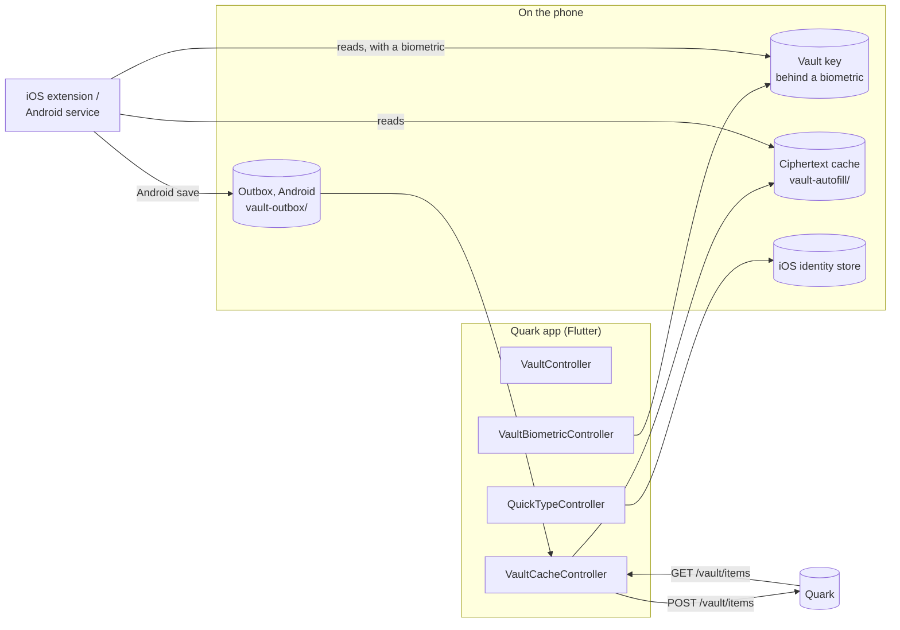

# Native vault autofill

How the phone apps fill vault logins into other apps: the iOS AutoFill Credential Provider extension and the Android
autofill service, the biometric unlock they depend on, the ciphertext they read, and what each piece stores, shows
the operating system, and clears. This is what was built for the epic
[#3592](https://github.com/autobutler-org/quark/issues/3592). The reasoning behind it, the options turned down, and the
questions still open for the owner are in [#3706](https://github.com/autobutler-org/quark/issues/3706), which is still
**Proposed**: the owner has not accepted it, and the open questions there are not answered. That proposal used to be
`docs/design/native-autofill-vault.md`; [#3708](https://github.com/autobutler-org/quark/issues/3708) moved it out of the
repo, so this page does not put it back. Where the code differs from the proposal, this page says so.

The user's side is journeys JN-VT-024 to JN-VT-034 in [`docs/user-journeys/vault.md`](../user-journeys/vault.md). The
vault itself, its keys and its server side are in [Data](data.md#the-vault) and
[Chat security](../chat-security.md#the-vault).

## What is verified and what is not

Read this first. Every piece below is covered by unit tests: Dart tests under `test/`, JVM tests under
`android/app/src/test/` (`make test/unit/android`), and `swift test` for `ios/QuarkVaultCrypto` (`make test/unit/ios`).
No commit or PR in the epic records a run on a real phone, an emulator or a simulator. Until one is recorded, treat
these as **not verified on a device**:

- the Android service filling Chrome, another browser or a native app, and the save prompt;
- the iOS extension filling Safari or an app, and QuickType suggestions;
- the biometric prompts, enrollment-change invalidation and reboot behavior on either platform;
- the iOS extension's memory use. The design asks for an Instruments measurement before #3598 closes, and none is
  recorded.

What is still open:

| Item | Where |
| --- | --- |
| The iOS extension is not in any signed build. CI builds it unsigned until the `IOS_AUTOFILL_PROVISIONING_PROFILE_BASE64` secret exists, and the App ID, app group and profile have to be registered in Apple's portal first ([`docs/ios-release.md`](../ios-release.md)). | [#3662](https://github.com/autobutler-org/quark/issues/3662), [#3598](https://github.com/autobutler-org/quark/issues/3598) |
| The browser extension drops vault item fields it does not know, so editing an entry there removes its Android app link (`androidApps`). | [quark-browser-extensions#185](https://github.com/autobutler-org/quark-browser-extensions/issues/185) |
| Nothing in the app can link an entry to an Android app. An entry fills a native app only through the app's verified sites, unless something else wrote `androidApps`. The design's "ask the user to link an entry the first time they pick it for an app" is not built. | follow-up to [#3601](https://github.com/autobutler-org/quark/issues/3601) |
| The iOS ciphertext cache is not excluded from device backups, as the design asked. It is ciphertext and the key is not backed up, so a restored copy opens nothing, but it does reach the backup. | follow-up to [#3596](https://github.com/autobutler-org/quark/issues/3596) |
| Whether the iOS extension can open Quark is untested, so it says "open Quark" in words and has no button. | [#3598](https://github.com/autobutler-org/quark/issues/3598) |
| Recent Chrome versions on Android hand forms to another autofill service only after Chrome's own setting allows it. The app does not mention that setting. | not filed |
| The owner's questions Q1 to Q9 in the design are unanswered. The code follows the design's recommendations. | [#3594](https://github.com/autobutler-org/quark/issues/3594) |

## The pieces

The extension and the service never talk to the Quark, never hold a session, never see the login password and never
run Argon2id. They have no Flutter engine. Everything they need, the app has left on the device beforehand.

| Piece | Code | Issue |
| --- | --- | --- |
| Native crypto: open an item, check the key fingerprint, match a host, read the item JSON, and (Android) seal an item | `ios/QuarkVaultCrypto` on swift-sodium; `org.autobutler.vaultcrypto` on lazysodium-android. Pinned to the Dart by `test/fixtures/vault_vectors.json` | #3597 |
| Ciphertext cache | `lib/controllers/vault_cache_controller.dart`, `lib/services/vault_cache.dart`, `lib/services/native_vault_cache*.dart` | #3596 |
| Biometric unlock and the cached key | `lib/controllers/vault_biometric_controller.dart`, `lib/services/vault_biometric*.dart`; `ios/Runner/VaultKeychain.swift`; `org.autobutler.vaultkeystore` | #3595 |
| Android autofill service | `org.autobutler.autofill` (`QuarkAutofillService`, `AutofillUnlockActivity`, `TrustedBrowsers`, `LoginForm`); the vault's setup card, `lib/widgets/vault/autofill_setup.dart` | #3600 |
| Android app matching | `org.autobutler.autofill.AppLinks`, `AssetLinkSource`; `androidApps` in `lib/models/vault_item.dart` | #3601 |
| Android save | `org.autobutler.autofill.AutofillSave`, `AutofillSaveActivity`; `lib/services/vault_outbox*.dart` | #3602 |
| iOS extension | `ios/CredentialProvider/` | #3598 |
| iOS QuickType suggestions | `lib/controllers/quicktype_controller.dart`, `ios/Runner/QuickTypeIdentities.swift` | #3599 |

### Platforms

- **Biometric unlock** is offered on iOS, and on Android 10 and later where the keystore is backed by secure hardware
  (StrongBox or the TEE) and a strong (Class 3) biometric is enrolled. Web and desktop builds never offer it and store
  nothing.
- **The Android service** is enabled from Android 8 (API 26), but it fills only with a cached key, so in practice it
  needs Android 10. Saving needs Android 10 too. The app still installs on Android 7.
- **The iOS extension** has the app's floor, iOS 15.0.

## How a fill works

**Android.** The user taps a login field. The system asks `QuarkAutofillService`, which finds the username and password
fields and decides who is asking:

- A browser on the `TrustedBrowsers` list (Chrome, Firefox, Firefox Focus, Samsung Internet, Edge, Brave, DuckDuckGo,
  Vivaldi, Opera), checked by package name and signing certificate, is believed about the website it reports.
- Any other app is matched as an app, by its package name and the SHA-256 digests of its signing certificates, never
  by the website it reports. An entry fills it when a site the app claims in its manifest's `asset_statements` grants
  it `delegate_permission/common.get_login_creds` in that site's own `https://<site>/.well-known/assetlinks.json`, or
  when the entry's `androidApps` link names the package under the same certificates. The site's file is fetched from
  the site, never through Google, and kept for a day in `cacheDir/asset-links/`.
- Anything it cannot check fills nothing.

With a cached key it offers one suggestion, "Use a saved login for bank.example". Tapping it opens
`AutofillUnlockActivity`, which plans again from what the system hands it, shows a strong-biometric prompt naming the
site and the app ("Fill your bank.example login into Chrome?"), opens the key through a `CryptoObject`-bound
`BiometricPrompt`, opens the cached items, zeroes the key, and returns the matching logins as suggestions. Picking one
fills it. Suggestions show a name and a username, never a password. With no cached key, or a key that is stale, it
offers "Open Quark and unlock your vault to use autofill" instead, which opens the app and fills nothing.

**iOS.** The user picks Quark from the keyboard's passwords button, or a QuickType suggestion. The extension reads every
cache file in the app group, reads the key for each from the shared Keychain access group (one Face ID or Touch ID
prompt), checks it against the fingerprint stored beside it, and lists the logins whose host matches what iOS says is
being filled, matched as the app's `entriesForUrl` matches. Only the picked login's password is opened. If the cache
is more than a week old, the list says "Last updated <date>. Open Quark to refresh."

Only the account signed in on the active Quark has a cached key, so in practice one account fills. The extension can
list several, labeled by account, if more than one cache is present.

## Security model

### What is stored where

| What | Where | Protection | Holds |
| --- | --- | --- | --- |
| **Vault key** (iOS) | Keychain, service `org.autobutler.quark.vault`, one item per account, in access group `4NK7MWUA57.org.autobutler.quark.shared` (the app and the extension) | `kSecAttrAccessibleWhenPasscodeSetThisDeviceOnly` with `.biometryCurrentSet`: needs Face ID or Touch ID on every read, no passcode fallback, never synced or backed up, deleted by iOS if the passcode is turned off | the 32-byte vault key, and its fingerprint in `kSecAttrGeneric` |
| **Vault key** (Android) | A small file per account, sealed under the AndroidKeyStore key `quark_vault_autofill_v1`, in app-private storage | AES-256-GCM key that needs a strong biometric for every use through a bound `CryptoObject`, is invalidated by a new enrollment, needs an unlocked device, prefers StrongBox, and is refused when software-only. Keystore keys never leave the device | the vault key, sealed, and its fingerprint |
| **Ciphertext cache** | iOS: `Library/Application Support/vault-autofill/` in the app group `group.org.autobutler.quark`. Android: `noBackupFilesDir/vault-autofill/` | iOS: `completeUntilFirstUserAuthentication`, **not** excluded from backup (see open items). Android: app-private, skipped by Auto Backup | one file per account: the Quark's address, the username, the key fingerprint, when it was synced, and each item's id, ciphertext, nonce and `formatVersion`, exactly as `GET /api/v0/vault/items` returned them |
| **Outbox** (Android save) | `noBackupFilesDir/vault-outbox/<account key>.<random>.json`, at most 50 waiting | app-private | one sealed item and the fingerprint of the key it was sealed under |
| **A login waiting to be saved** (Android) | the service's process memory, behind a random token, at most four, each for five minutes | never written down or put in an intent | the typed username and password, until the save prompt seals them |
| **QuickType identities** (iOS, opt-in) | iOS's credential identity store | **not encrypted by Quark**: iOS keeps them | per login: the site's host, the username, and a record id `<account key>/<item id>`. Never a password or a full URL |
| **The setting itself** | iOS/Android keystore entry above; QuickType's opt-in in the app's preferences | | biometric unlock is "on" exactly when a key is cached for the active account |

The account key that names files and entries is `acct_` and the first 32 hex digits of SHA-256 over the normalized
host, a zero byte and the username. The fingerprint is keyed BLAKE2b over a fixed label, 16 bytes, and says nothing
about the key without the key.

Nothing writes a decrypted item, a password or the vault key in the clear to disk. The cache holds only bytes the
Quark already holds. The extension and the service hold the key in memory for the moment of a fill or a save and zero
it after.

### What the operating system sees

- **Both.** That Quark is the chosen autofill provider, and the biometric prompt's text. The key's protection is the
  OS's secure hardware, so a compromised OS on an unlocked phone can wait for the user to fill (the design's threat
  model, "A rooted or jailbroken phone").
- **iOS.** The service identifiers (domains or app identifiers) being filled, which iOS sends the extension. The
  username and password of the login the user picks, which the extension hands back to iOS to fill. With QuickType on,
  the host and username of every login, stored unencrypted in iOS's identity store.
- **Android.** The structure of the form being filled, which the requesting app builds. The suggestions Quark returns
  (a name and a username each) and the username and password of the login picked. On a save, the system sends Quark
  what the user typed.
- **Networks.** For a native Android app, the site it claims and that site's DNS learn that this phone asked for its
  `assetlinks.json`. No package name and nothing from the vault is sent anywhere. The iOS extension makes no network
  call.

### What is cleared when

| Event | Cached key | Ciphertext cache | QuickType identities | Outbox |
| --- | --- | --- | --- | --- |
| Lock button, or 15 minutes idle | kept | kept | kept | kept |
| Biometric unlock turned off | deleted | kept: it is ciphertext | emptied, setting off | kept |
| QuickType turned off | kept | kept | emptied | kept |
| Sign-out, or a switch of account or Quark | deleted | deleted, before the next account's is written | emptied, setting off | kept |
| Password change on this device | deleted | kept | emptied, setting off | kept |
| Start over, or the vault deleted from any session | deleted | deleted | emptied, setting off | kept; dropped later because no key opens it |
| A face or fingerprint added or removed | the OS refuses it; the next read deletes it | kept | emptied, setting off | kept |
| Cached key found stale (fingerprint mismatch, or no item opens under it) | deleted | deleted | emptied, setting off | items sealed under another key are dropped |
| Phone passcode turned off | iOS deletes it; Android invalidates the key | kept | kept until the app finds the key gone | kept |
| Password change or recovery on another device | kept **until the app next talks to the Quark**, gets a 401 and signs out | as for sign-out, then | as for sign-out, then | kept |
| App uninstalled | Android: gone. iOS: the Keychain item survives, and the next install's first launch deletes it | gone | left to iOS | gone |

The outbox is uploaded by the app on a cache refresh while the vault page is open under the same key, compared by
fingerprint. An item sealed under any other key is dropped, because nobody could open it, and one the Quark rejects as
malformed is dropped. Anything else waits for the next refresh.

**Signing out elsewhere does not stop autofill at once.** Changing the password on another device signs this phone's
session out on the Quark, but the extension and the service have no session to lose. Until the Quark app runs on the
phone again, autofill keeps filling from the last cache, still behind a biometric on every fill. This is the
design's Q5, and it is unanswered.

### Two promises that changed

- **The vault key is on the device.** Before biometric unlock, the key lived in the app's memory only. Turned on, it is
  kept on the device behind a biometric, so whoever can pass Face ID, Touch ID or a fingerprint on the unlocked phone
  can open the vault and fill from it. It is opt-in per device, off by default, and the setting says so before it is
  turned on.
- **Site addresses and usernames outside the vault (iOS, QuickType only).** iOS keeps them unencrypted. The setting
  says so before it is turned on.
